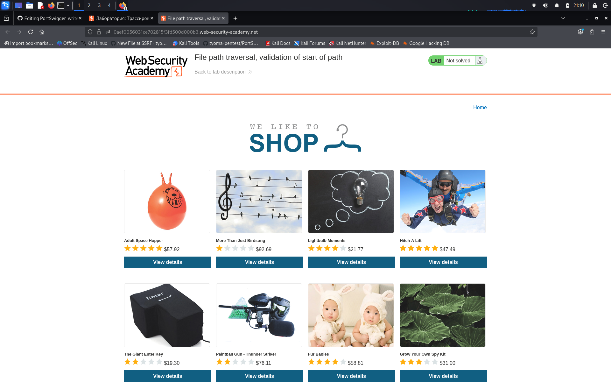

# File path traversal, validation of start of path

**Сложность:** Practitioner  
**Тема:** Path traversal  
**Ссылка:** [PortSwigger](https://portswigger.net/web-security/file-path-traversal/lab-validate-start-of-path)  

# 1. Описание уязвимости

Эта лаборатория содержит уязвимость прохождения пути в отображении изображений продукта. Приложение передает полный путь файла через параметр запроса и подтверждает, что поставляемый путь начинается с ожидаемой папки.

---

# 2. Разведка

Открыл лабораторную - изображения загружаются через параметр `filename` в URL. Сервер проверяет, что путь начинается с определённой директории (например, `/var/www/images/`). Попытки использовать `../../../etc/passwd` не работают. Значит, нужно сохранить валидное начало пути, а затем выйти за его пределы через `../`.

---

# 3. Ход решения

