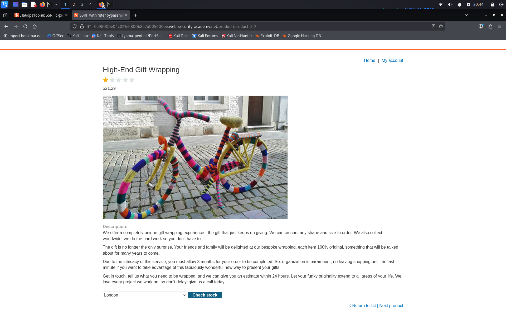

# SSRF with filter bypass via open redirection vulnerability

**Сложность:** Practitioner  
**Тема:** SSRF  
**Ссылка:** [PortSwigger](https://portswigger.net/web-security/ssrf/lab-ssrf-filter-bypass-via-open-redirection)  

## 1. Описание уязвимости

В этой лаборатории есть функция проверки запасов, которая извлекает данные из внутренней системы.

---

## 2. Разведка

Открыл лабораторную - это интернет-магазин. Чтобы решить лабораторную, надо будет изменить `URL` проверки запасов, чтобы получить доступ к интерфейсу администратора на `http://192.168.0.12:8080/admin` и удалить пользователя `carlos`.

