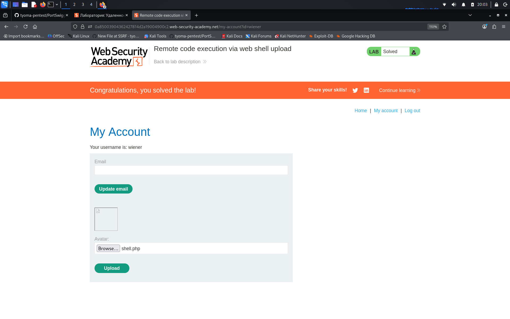
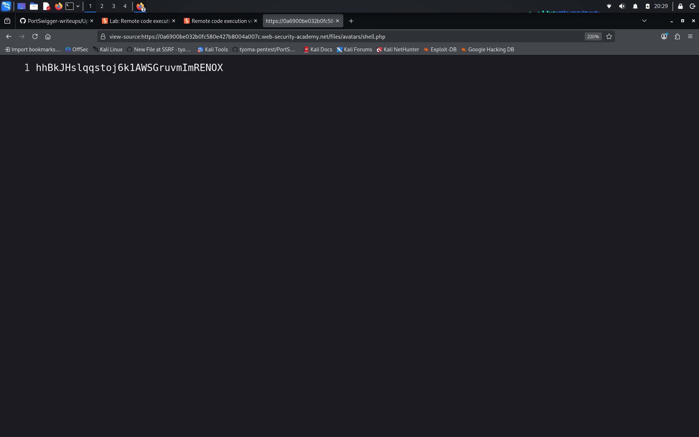

# Remote code execution via web shell upload

**Сложность:** Apprentice  
**Тема:** Upload file  
**Ссылка:**  [PortSwigger](https://portswigger.net/web-security/file-upload/lab-file-upload-remote-code-execution-via-web-shell-upload)  

## 1. Описание уязвимости

Эта лаборатория содержит уязвимую функцию загрузки изображений. Он не выполняет никаких проверок файлов, которые пользователи загружают перед хранением их в файловой системе сервера. Чтобы решить лабораторию, загрузите базовую веб-оболочку PHP и используйте ее для извлечения содержимого файла `home/carlos/secret`. Отправьте эту тайну, используя кнопку, указанную в лабораторном баннере.

## 2. Разведка

Открыл лабораторную - интернет-магазин с функцией загрузки аватара в личном кабинете. Изучил форму загрузки: сервер принимает файл, но при попытке загрузить текстовый файл или файл без расширения выдает ошибку. Проверил, какие расширения разрешены - `.php` проходит без ошибок. Это значит, что сервер не проверяет содержимое файла (например, что это действительно картинка) и позволяет загружать исполняемые скрипты. Следовательно, можно загрузить веб-шелл и выполнить команды на сервере.

---

## 3. Ход решения

Создал PHP-файл `shell.php` с кодом `<?php echo file_get_contents('/home/carlos/secret'); ?>`. Загрузил его через форму смены аватара. посмотрел исходный код страницы, чтобы найти путь к загруженному файлу - `/files/avatars/shell.php`. Открыл этот URL в браузере. Сервер выполнил PHP-код и вывел содержимое секретного файла `/home/carlos/secret`. Скопировал секрет и отправил его в поле решения. Лаба решена.

А на этом скриншоте можно заметить, как я перешел в `/files/avatars/shell.php` и получил доступ к секрету пользователя `carlos`:

---

## 4. Причина уязвимости

Приложение принимает файлы от пользователя и сохраняет их в директории, доступной из веб-корня, но не проверяет ни расширение, ни тип содержимого. Из-за этого злоумышленник может загрузить исполняемый скрипт (например, `.php`), который сервер впоследствии выполнит при обращении к нему по URL. Это приводит к удаленному выполнению кода (RCE).
