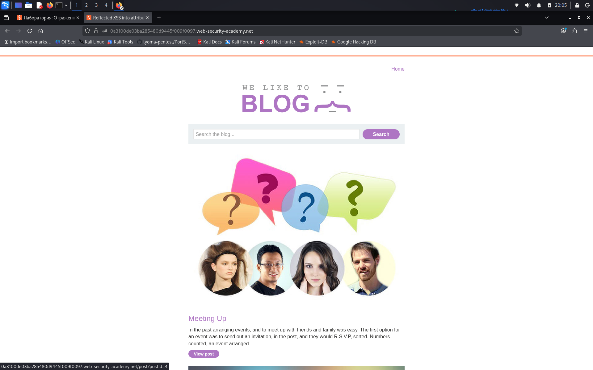
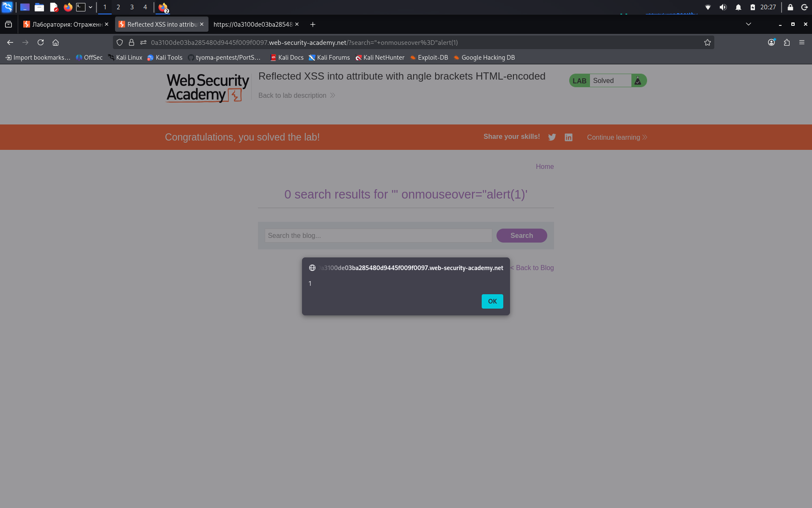

# Reflected XSS into attribute with angle brackets HTML-encoded

**Сложность:** Apprentice  
**Тема:** XSS  
**Ссылка:** [PortSwigger](https://portswigger.net/web-security/cross-site-scripting/contexts/lab-attribute-angle-brackets-html-encoded)  

## 1. Описание уязвимости

Эта лаборатория содержит отраженную уязвимость кросс-сайтов в функциональности поискового блога, где угловые скобки кодируются `HTML-кодом`. Чтобы решить эту лабораторию, выполните атаку по сценарию, которая вводит атрибут и называет `alert` функция.

---

## 2. Разведка

Открыл лабораторную - это сайт с блогами, присутсвует параметр `search the blog`, так же под блогами можно оставлять коментарии.

---

## 3. Ход решения

Открыл лабораторную - форма поиска. Ввёл `test` и посмотрел исходный код: значение отражается в атрибуте `value` без экранирования кавычек. Угловые скобки экранируются, но `"` - нет. Использовал payload `" onmouseover="alert(1)" autofocus="`. Он закрыл атрибут `value` и добавил `onmouseover` - при каждом наведении курсора на параметр `search` происходит `alert(1)`. Лаба решена.

---

*Вместо `onmouseover` может быть большое количество других атрибутов, к примеру: onfocus, onclick, on  keydown, onload, ontoggle и другие**
