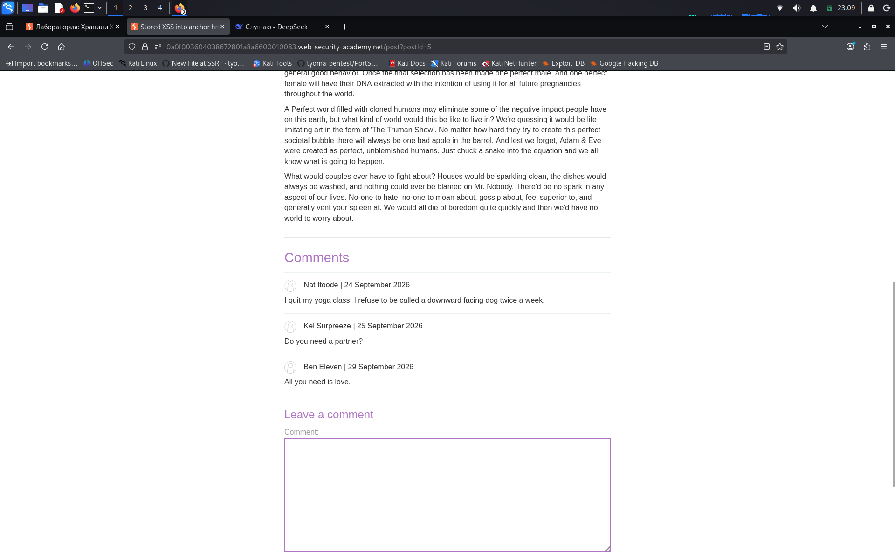

#   Stored XSS into anchor href attribute with double quotes HTML-encoded

**Сложность:** Apprentice  
**Тема:** XSS  
**Ссылка:** [PortSwigger](https://portswigger.net/web-security/cross-site-scripting/contexts/lab-href-attribute-double-quotes-html-encoded)  

## 1. Описание уязвимости

Эта лаборатория содержит сохраненную уязвимость сценариев кросс-сайта в функциональности комментария.

---

## 2. Разведка

Открыл лабораторную - сайт с блогами. Под блогами можно оставлять комментарии. Чтобы решить эту лабораторию, надо отправить комментарий, который звонит `alert` функция при нажатии на имя автора комментария.

---

## 3. Ход решения

