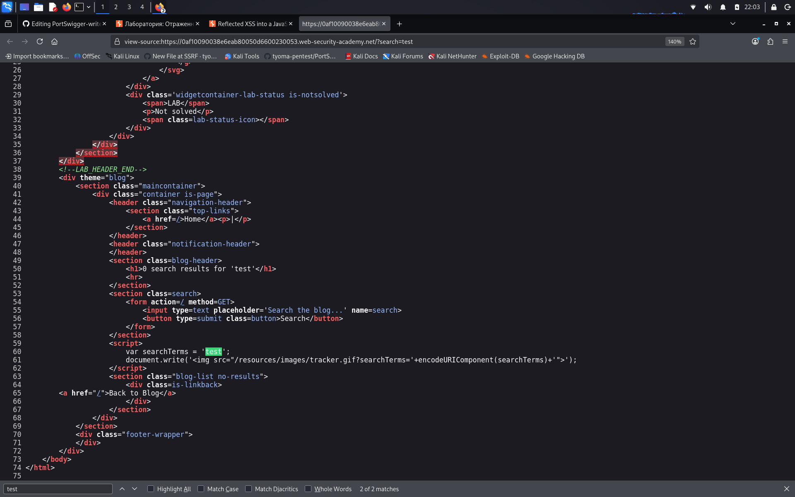
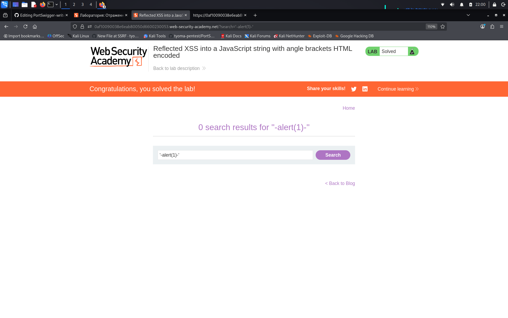

# Reflected XSS into a JavaScript string with angle brackets HTML encoded

**Сложность:** Apprentice  
**Тема:** XSS  
**Ссылка:** [PortSwigger](https://portswigger.net/web-security/cross-site-scripting/contexts/lab-javascript-string-angle-brackets-html-encoded)  

## 1. Описание уязвимости

Эта лаборатория содержит отраженную уязвимость кросс-сайтов в функции отслеживания поисковых запросов, где кодируются угловые скобки. Рефлексия происходит внутри струны JavaScript. Чтобы решить эту лабораторию, выполните атаку поперечного скрипта, которая вырывается из строки JavaScript и вызывает `alert` функцию.

---

## 2. Разведка

Открыл лабораторную - блог с формой поиска. Ввёл `test` и посмотрел исходный код (Ctrl+U). Обнаружил, что ввод отражается внутри JavaScript-переменной: `var searchTerms = 'test';`. Угловые скобки (`<`, `>`) экранируются, поэтому теги `<script>` не сработают. Однако одинарные кавычки (`'`) не экранируются. Значит, можно вырваться из строки, закрыв кавычку, и выполнить свой код.

---

## 3. Ход решения

Ввёл в форму поиска payload `'-alert(1)-'`. Сервер подставил его в JavaScript-код: `var searchTerms = ''-alert(1)-'';`. Одинарные кавычки закрыли строку, а дефисы (`-`) превратили вызов функции в валидное математическое выражение. При загрузке страницы сработал `alert(1)`. Браузер пытается вычесть строку из функции (это даст NaN), но главное - функция alert(1) уже выполнилась. Лаба решена.

---
