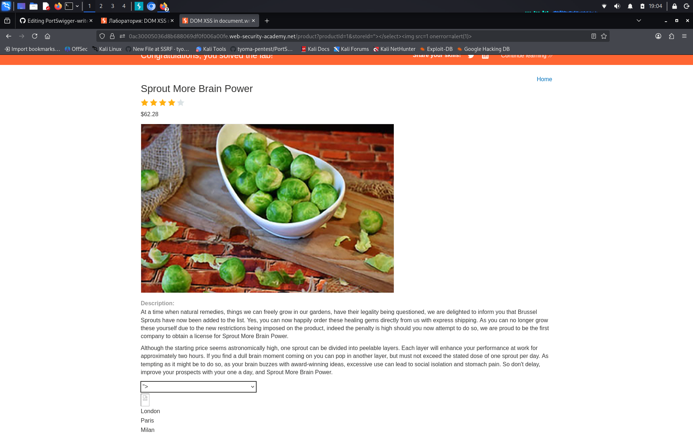

# DOM XSS in document.write sink using source location.search inside a select element

**Сложность:** Practitioner  
**Тема:** XSS  
**Ссылка:** [PortSwigger](https://portswigger.net/web-security/cross-site-scripting/dom-based/lab-document-write-sink-inside-select-element)  

## 1. Описание уязвимости

Эта лаборатория содержит уязвимость кросс-сайтов на основе DOM в функциональности проверки запасов. Он использует JavaScript `document.write` функция, которая записывает данные на страницу. The `document.write` функция называется с данными из `location.search` который вы можете контролировать с помощью `URL-адреса` веб-сайта. Данные заключены в избранный элемент.

---

## 2. Разведка

Открыл лабораторную - интернет-магазин. На странице товара есть форма проверки наличия (Check stock) с выпадающим списком магазинов. Изучил исходный код страницы (Ctrl+U) и обнаружил JavaScript, который берет параметр `storeId` из URL и передает его в `document.write` внутри тега `<select>`. Так как контекст - это выпадающий список, обычные теги вроде `` внутри него не выполняются. Значит, нужно сначала закрыть тег `</select>`, а затем внедрить полезную нагрузку.

---

## 3. Ход решения

Параметр `storeId` передается в `document.write` внутри тега `<select>`, поэтому тег `` там не выполнится. Использовал payload `1&storeId="></select>`: конструкция `"></select>` закрыла выпадающий список, а тег `` выполнился вне его контекста. Сработал `alert(1)`. Лаба решена.

---

## 4. Причина уязвимости

Уязвимость возникает из-за того, что JavaScript берет значение из URL (`location.search`) и передает его в `document.write` без какой-либо проверки. Разработчик не учел, что злоумышленник может использовать закрывающие теги (`">`, `</select>`), чтобы разорвать контекст выпадающего списка и внедрить произвольный HTML-код с исполняемым JavaScript.
