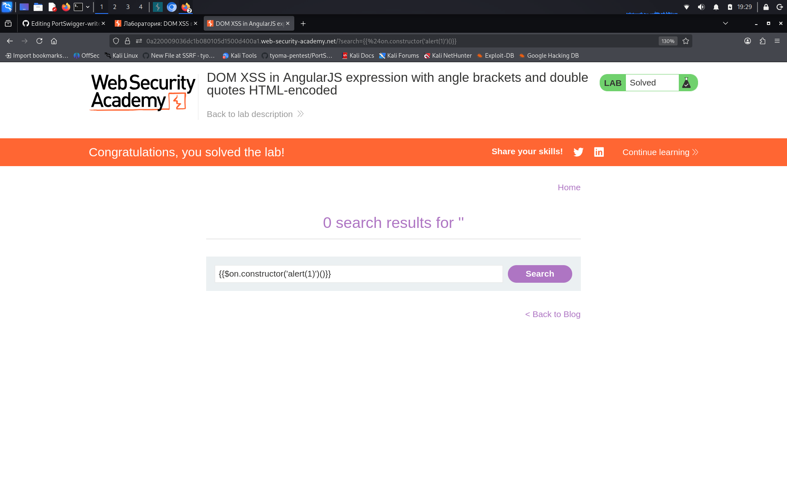

# DOM XSS in AngularJS expression with angle brackets and double quotes HTML-encoded

**Сложность:** Practitioner  
**Тема:** XSS  
**Ссылка:** [PortSwigger](https://portswigger.net/web-security/cross-site-scripting/dom-based/lab-angularjs-expression)  

## 1. Описание уязвимости

Эта лаборатория содержит уязвимость кросс-сайтов на основе DOM в экспрессии `AngularJS` в функциональности поиска. `AngularJS` - популярная библиотека JavaScript, которая сканирует содержимое HTML-узлов, содержащих `ng-app` атрибут (также известный как директива AngularJS). Когда в HTML-код добавлена директива, вы можете выполнять выражения JavaScript в двойных вьющихся брекетах. Этот метод полезен, когда кодируются угловые кронштейны.

---

## 2. Разведка 

Открыл лабораторную - сайт с блогами, есть параметр `search`, так же под блогами можно оставлять комментарии. Ввёл `test` и посмотрел исходный код (Ctrl+U). Обнаружил, что приложение использует фреймворк **AngularJS** (наличие атрибута `ng-app` и фигурных скобок `{{ }}` в HTML). Так как угловые скобки и двойные кавычки экранируются, использовать обычные теги (`<script>`, ``) бесполезно. Однако AngularJS автоматически вычисляет выражения внутри `{{ }}`. Значит, можно внедрить код.

---

## 3. Ход решения

Ввёл в форму поиска payload `{{$on.constructor('alert(1)')()}}`. Угловые скобки и двойные кавычки здесь не используются, поэтому фильтр их не заблокировал. AngularJS распознал выражение в двойных фигурных скобках и выполнил его. Цепочка `$on.constructor` позволила получить доступ к функции `Function`, которая скомпилировала строку `'alert(1)'` в исполняемый код, а вызов `()` в конце запустил его. Сработал `alert(1)`. Лаба решена.

---

## 4. Причина уязвимости

Приложение использует фреймворк AngularJS для динамического отображения данных и вставляет пользовательский ввод в DOM без надлежащей санитизации. Хотя угловые скобки и кавычки экранируются, AngularJS автоматически вычисляет выражения внутри двойных фигурных скобок `{{ }}`. Это позволяет злоумышленнику внедрить вредоносное выражение, которое AngularJS интерпретирует как код и выполняет в браузере жертвы.
