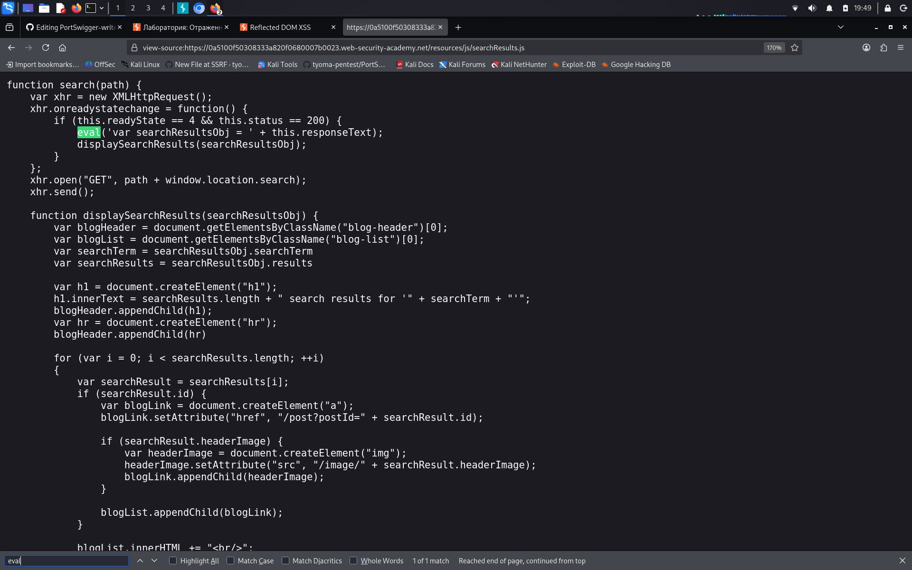
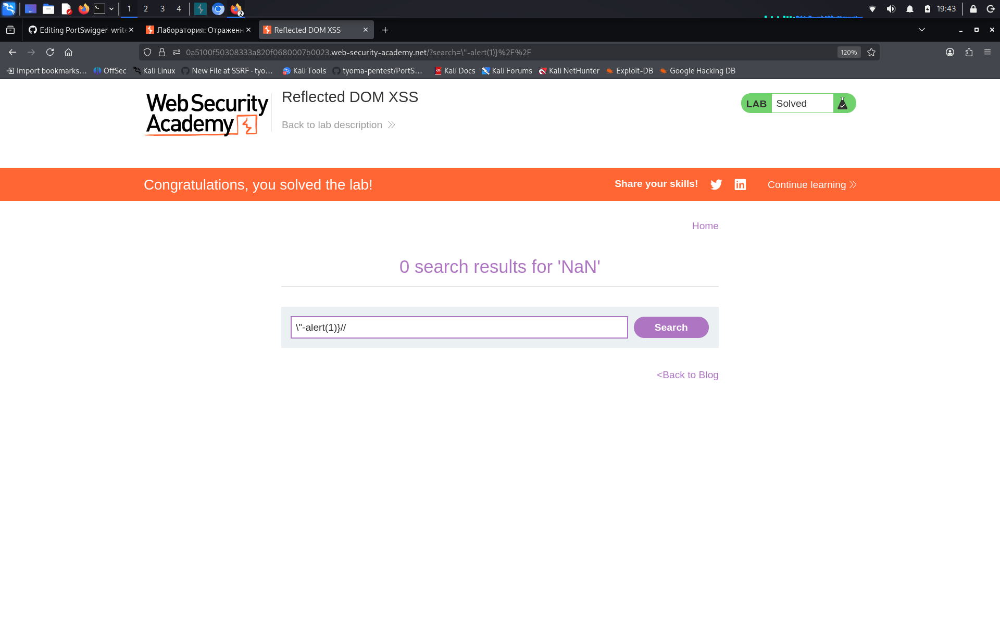

# Reflected DOM XSS

**Сложность:** Practitioner  
**Тема:** XSS  
**Ссылка:** [PortSwigger](https://portswigger.net/web-security/cross-site-scripting/dom-based/lab-dom-xss-reflected)  

## 1. Описание уязвимости

Эта лаборатория демонстрирует отраженную уязвимость DOM. Отраженные уязвимости DOM возникают, когда серверная пристройка обрабатывает данные из запроса и перекликается с данными в ответе. Скрипт на странице затем обрабатывает отраженные данные небезопасным способом, в конечном итоге записывая их в опасную раковину.

---

## 2. Разведка

При вводе в поиск отправляется запрос, который возвращает JSON. Изучив скрипт `searchResults.js`, я обнаружил, что приложение использует функцию `eval()` для парсинга JSON. При вводе кавычек сервер их экранирует, однако обратный слэш (`\`) не экранируется, что позволяет обойти фильтр.

---

## 3. Ход решения 

Использовал payload `\"-alert(1)}//`. Так как сервер не экранирует обратный слэш, в JSON-ответе образовывалась последовательность `\\"`, которая в `eval()` закрывала строку, выполняла `alert(1)` и комментировала остаток кода через `//`. Лаба решена.

---

## 4. Причина уязвимости

Приложение использует функцию `eval()` для обработки JSON-ответа от сервера. Разработчики попытались защититься, экранируя двойные кавычки, но забыли экранировать обратный слэш (`\`). Из-за этого злоумышленник может передать `\`, который "съедает" экранирующий слэш сервера, делая кавычку активной. Это позволяет вырваться из строки и выполнить произвольный JavaScript-код.
